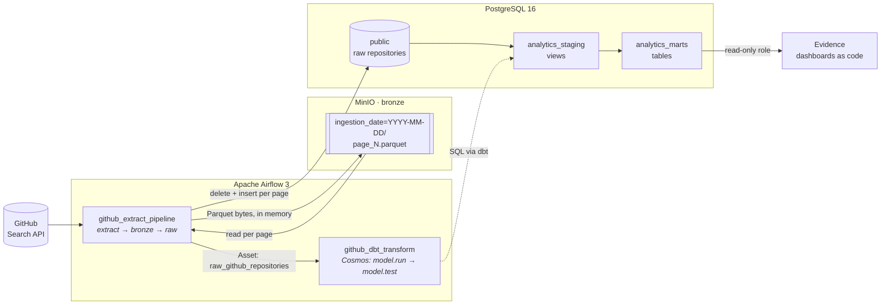
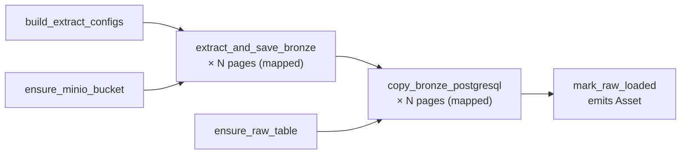
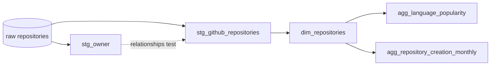

<div align="center">

# GitHub Analytics Platform

**An end-to-end data platform that collects repository data from the GitHub API, stores it in a lakehouse-style bronze layer, models it with dbt, and serves it as dashboards defined in code.**

[](https://www.python.org/)
[](https://airflow.apache.org/)
[](https://www.getdbt.com/)
[](https://github.com/astronomer/astronomer-cosmos)
[](https://www.postgresql.org/)
[](https://min.io/)
[](https://pola.rs/)
[](https://docs.evidence.dev/)
[](https://docs.docker.com/compose/)
[](https://docs.astral.sh/uv/)

[Architecture](#architecture) •
[How it works](#how-it-works) •
[Quick start](#quick-start) •
[Engineering decisions](#engineering-decisions) •
[Roadmap](#roadmap)

</div>

---

## Overview

The platform answers a simple question: *what do public data engineering repositories on GitHub look like?* That covers who builds them, how popular they are, how they're licensed, and how activity changes over time. The question is deliberately small. The point of the project is the **platform around it**: every layer is the kind you'd find in a production data stack.

**Highlights**

- 🔄 **Orchestrated ELT with Airflow 3.** Dynamic task mapping fetches one API page per task; asset-based scheduling links ingestion to transformation.
- 🪣 **Bronze layer in object storage.** Raw API responses go straight to MinIO (S3 compatible) as Parquet, partitioned by ingestion date.
- ♻️ **Idempotent loads.** Re-runs and retries replace data instead of duplicating it, at both the bronze and warehouse levels.
- 🧱 **dbt modelling with tests.** Staging → marts layers, 20 data tests, run by Cosmos as one Airflow task per model.
- 📊 **Dashboards as code.** Evidence pages are Markdown + SQL in git, read through a least-privilege database role.
- 🐳 **One-command local stack.** Everything runs in Docker Compose; Python environments are pinned with uv lockfiles.

## Architecture



## Tech stack

| Layer | Technology | Role in the project |
|---|---|---|
| Orchestration | **Apache Airflow 3.3** (TaskFlow API, LocalExecutor) | Schedules and monitors ingestion and transformation; dynamic task mapping, assets |
| Ingestion | **Python 3.13**, `requests` + `tenacity`, **Polars** | GitHub API client with retry and backoff; DataFrame processing and Parquet serialization |
| Object storage | **MinIO** (S3 API via `boto3`) | Bronze layer: immutable Parquet snapshots of every API page |
| Warehouse | **PostgreSQL 16**, SQLAlchemy 2, psycopg 3 | Raw table plus dbt-built staging and mart schemas |
| Transformation | **dbt-core 1.12** + dbt-postgres, **dbt_utils** | Typed staging models, deduplicated dimension, aggregate marts, data tests |
| dbt in Airflow | **astronomer-cosmos 1.16** | Turns the dbt project into an Airflow task group (one run and one test task per model) |
| BI | **Evidence** (Core, self-hosted) | Dashboards written as Markdown + SQL, version-controlled with the rest of the code |
| Infrastructure | **Docker Compose**, pgAdmin | Reproducible local environment for every service |
| Tooling | **uv**, ruff, pre-commit, Make | Locked dependencies, linting, short commands for common tasks |

## How it works

### 1. Extract → bronze (`github_extract_pipeline`)



1. `build_extract_configs` creates one config per search-results page.
2. `extract_and_save_bronze` is **dynamically mapped**: each task fetches one page, serializes it to Parquet **in memory**, and puts it into MinIO at
   `…/bronze/github/repositories/ingestion_date=YYYY-MM-DD/page_N.parquet`. Pages past the last search result are **skipped**, not failed.
3. `copy_bronze_postgresql` expands over the extract output, so page *i* is loaded as soon as page *i* is in MinIO. It reads the object from MinIO, flattens it to the raw schema (nested JSON kept as text), and **replaces** that page's rows in Postgres.
4. `mark_raw_loaded` is a single non-mapped task that emits the `raw_github_repositories` **Asset**, once per run.

### 2. Transform (`github_dbt_transform`)

The dbt DAG has no cron schedule. It is **triggered by the asset**, so transformations always run right after fresh data lands. Cosmos renders every dbt model as a `run` task followed by a `test` task, so a failing test stops everything downstream of that model.



| Layer | Schema | Materialization | Models | Purpose |
|---|---|---|---|---|
| Staging | `analytics_staging` | view | `stg_github_repositories`, `stg_owner` | Cast types, rename columns, unpack JSON (`jsonb_to_record`); same grain as the raw table |
| Marts | `analytics_marts` | table | `dim_repositories` | One row per repository: its **latest** snapshot, plus derived fields |
| Marts | `analytics_marts` | table | `agg_language_popularity`, `agg_repository_creation_monthly` | Dashboard-ready aggregates |

**Data quality:** 20 tests cover `not_null`, `unique`, `relationships`, and `accepted_values`, plus `dbt_utils.accepted_range` and `unique_combination_of_columns`.

### 3. Serve (Evidence)

Dashboards live in [`evidence/`](evidence/) as Markdown pages with SQL. They query **only** the marts, through a dedicated read-only role. See [evidence/README.md](evidence/README.md) for details.

| Page | Contents |
|---|---|
| **Overview** | KPIs (repositories, stars, forks, median stars), top repositories and owners, creation trends, licenses and languages |
| **Repository Explorer** | License and owner filters, filtered KPIs, searchable table with links to GitHub |

<!-- Add screenshots here, e.g.:
<p align="center"></p>
-->

## Quick start

### Prerequisites

- Docker with Docker Compose v2
- A [GitHub personal access token](https://github.com/settings/tokens) (read-only access to public data is enough)
- A MinIO AIStor license file (`minio.license`) in the project root (the Compose file uses the AIStor image)
- *Optional, for running dbt outside Docker:* [uv](https://docs.astral.sh/uv/)

### Run the stack

```bash
git clone https://github.com/aandrewprdn/github-analytics-platform.git
cd github-analytics-platform

cp .env.example .env          # fill in the values (see below)
docker compose up -d --build  # Postgres, MinIO, Airflow, Evidence, pgAdmin
make evidence-setup           # create the read-only role for dashboards
```

Key `.env` values:

| Variable | Example | Notes |
|---|---|---|
| `GITHUB_API_TOKEN` | `ghp_…` | Used by the extract tasks |
| `POSTGRES_HOST` / `POSTGRES_USER` / `POSTGRES_PASSWORD` / `POSTGRES_DB` | `de-postgres` / … | Shared by Airflow, dbt and Evidence |
| `POSTGRES_RAW_TABLE_NAME` | `github_repositories` | Raw landing table |
| `AIRFLOW__API_AUTH__JWT_SECRET` | output of `openssl rand -hex 32` | Required by the Airflow 3 API server |
| `MINIO_ENDPOINT_URL` / `MINIO_BUCKET_NAME` / `MINIO_ROOT_*` | `http://de-minio:9000` / `github-analytics` | Bronze storage |
| `EVIDENCE_DB_USER` / `EVIDENCE_DB_PASSWORD` | `evidence_reader` / random | Read-only dashboard role |

### Run the pipeline

1. Open Airflow at <http://localhost:8080>. The user is `admin`; the password is generated on first start:
   ```bash
   docker compose logs airflow-api-server | grep "Password for user"
   ```
2. **Unpause both DAGs.** New DAGs start paused, and a paused `github_dbt_transform` won't react to the asset.
3. Trigger `github_extract_pipeline`. When it finishes, `github_dbt_transform` starts automatically.
4. Open the dashboards at <http://localhost:3000>.

### Services

| Service | URL | Purpose |
|---|---|---|
| Airflow | <http://localhost:8080> | DAGs, runs, logs |
| Evidence | <http://localhost:3000> | Dashboards (localhost only) |
| MinIO console | <http://localhost:9001> | Browse bronze Parquet files |
| pgAdmin | <http://localhost:5050> | Inspect the warehouse |
| PostgreSQL | `localhost:5432` | Direct SQL access |
| dbt docs | <http://localhost:8081> | After `make dbt-docs` |

## Local development

dbt runs on your machine in its own isolated uv environment, against the Postgres container:

```bash
make dbt-setup                 # install dbt + packages (once)
make dbt-build                 # run and test every model
make dbt-build s=stg_owner     # run one model (any dbt selector works)
make dbt-docs                  # lineage graph and docs on :8081
```

Dashboards reload on save. Edit `evidence/pages/*.md`, then:

```bash
make evidence-validate         # check syntax and run every query against Postgres
```

Changes in `src/` are installed into the Airflow image, so rebuild after editing: `docker compose build`.

## Engineering decisions

The interesting parts of the project are the details: problems that showed up during development and how they were solved.

<details>
<summary><b>♻️ Idempotent ingestion: re-runs never duplicate data</b></summary>

<br>

Bronze objects are keyed by `(ingestion_date, page)`, so a same-day re-run **overwrites** the same object. The warehouse load mirrors that: `replace_page_in_db()` deletes the rows of that `(day, page)` and inserts the new ones **in one transaction**. A retry, a manual re-run, or a crash halfway through leaves no duplicates and no half-loaded pages. A new day adds a new snapshot, which keeps history. `dim_repositories` then keeps only the latest snapshot of each repository using `row_number()`.
</details>

<details>
<summary><b>🪣 MinIO is the source of truth for bronze; no local files</b></summary>

<br>

Parquet is written to an in-memory buffer and uploaded with `put_object`, and the load task reads it back with `get_object` into memory. No task depends on a shared local disk, so the DAG works on any executor and any number of workers. An earlier version downloaded files to a local path, which turned out to overwrite (and then delete) the local landing copy.
</details>

<details>
<summary><b>🧩 Per-page lineage with dynamic task mapping</b></summary>

<br>

The load task expands over the **extract task's output**, not over a shared list. Page *i* is loaded as soon as page *i* is stored, and an empty, skipped page only skips its own load. With the earlier `uploads >> ensure_raw_table >> loads` chain, a single skipped page would silently skip the entire load.
</details>

<details>
<summary><b>📡 Data-aware scheduling with Airflow Assets</b></summary>

<br>

Ingestion and transformation are two DAGs linked by an Asset, so dbt can be re-run without calling the GitHub API again. The asset is emitted by a **single** non-mapped task (`trigger_rule="none_failed"`), because mapped tasks would emit one event per page and could start dbt several times.
</details>

<details>
<summary><b>🧪 dbt inside Airflow without dependency conflicts</b></summary>

<br>

dbt and Airflow pin incompatible libraries, so dbt is installed in a **separate virtualenv** inside the Airflow image, built from `dbt/uv.lock`, the same lockfile used locally. Cosmos calls that executable in `SUBPROCESS` mode. A subtle bug: mounting the project at `/opt/airflow/dbt` made Python treat the folder as a `dbt` namespace package, so Cosmos wrongly assumed dbt was importable. The project is therefore mounted at `/opt/airflow/dbt_project`.
</details>

<details>
<summary><b>🔐 Least privilege and secrets handling</b></summary>

<br>

- Evidence connects as `evidence_reader`, which can only `SELECT` from `analytics_marts`. It has no access to raw or staging tables, Airflow's tables, or any DDL. `ALTER DEFAULT PRIVILEGES` keeps the access working after dbt recreates tables.
- `evidence/connection.yaml` is committed, but holds only `${ENV_VAR}` references.
- Database URLs are built with SQLAlchemy `URL.create`, which escapes special characters in passwords.
- The Evidence dev server is bound to `127.0.0.1` because it has no login.
</details>

<details>
<summary><b>🧱 Raw stays raw; typing happens in dbt</b></summary>

<br>

The raw table stores timestamps and nested objects (`owner`, `license`) as text, exactly as received. Casting, JSON unpacking (`jsonb_to_record`), renaming and null handling happen in staging models, where they are versioned, tested and easy to change. Staging is views, so it is always current; marts are tables, so dashboards stay fast.
</details>

<details>
<summary><b>🌐 Resilient API client</b></summary>

<br>

`GithubClient` uses `tenacity` exponential backoff for connection errors and timeouts, detects rate-limit responses (`403` with `X-RateLimit-Remaining: 0`), and adds ingestion metadata (`ingested_at`, `page`, `query`) to every page. That metadata later provides the idempotency key and the snapshot ordering.
</details>

<details>
<summary><b>⚙️ Airflow 3 hygiene</b></summary>

<br>

- No `logging.basicConfig` at import time; it would override Airflow's logging in the DAG processor.
- Environment variables are read at **task run time**, not at DAG parse time, so a missing variable fails one task instead of breaking the whole DAG import.
- One-off tools (`dbt` container) are behind a Compose `profile`, so they don't run as restart-looping services.
</details>

## Project structure

```text
github-analytics-platform/
├── airflow/
│   └── dags/
│       ├── github_pipeline_dag.py    # extract → MinIO → Postgres, emits the asset
│       ├── github_dbt_dag.py         # Cosmos DbtDag, triggered by the asset
│       └── common/assets.py          # asset shared by both DAGs
├── src/github_analytics_platform/
│   ├── github_client.py              # GitHub API client (retries, rate limits)
│   ├── minio_client.py               # S3/MinIO helpers (put/read bytes)
│   └── copy_ingestions_postgre.py    # raw transform + idempotent page load
├── dbt/                              # dbt project (own uv env + lockfile)
│   ├── models/staging/               # stg_github_repositories, stg_owner
│   ├── models/marts/                 # dim_repositories, agg_* marts
│   └── profiles.yml                  # env-driven profile (local + Docker)
├── evidence/                         # dashboards as code (see evidence/README.md)
│   ├── pages/                        # home.md, repositories.md
│   └── queries/                      # shared SQL
├── docker/
│   ├── airflow/Dockerfile            # Airflow + Cosmos + isolated dbt venv
│   ├── dbt/Dockerfile                # standalone dbt image (uv, locked)
│   └── postgres/create_evidence_reader.sql
├── docs/                             # reference notes (API samples)
├── docker-compose.yml
├── Makefile                          # dbt-* and evidence-* shortcuts
└── pyproject.toml / uv.lock          # ingestion package + dev tools
```

## Roadmap

Known limitations, listed honestly, with the planned next steps:

- [ ] **Scheduling and parameters:** add a daily schedule and turn the search query and page count into DAG `params` (they're constants today).
- [ ] **Separate databases:** move Airflow's metadata out of the warehouse database.
- [ ] **CI:** a GitHub Actions workflow running `ruff`, `pytest`, `dbt parse`/`build` against a service container, and `evidence validate`.
- [ ] **Unit tests** for the API client and the transform/load functions (`test/` is still empty).
- [ ] **Pinned image versions** for MinIO and pgAdmin (currently `latest`).
- [ ] **Incremental models** and a dbt **snapshot** of repository metrics to track star growth over time.
- [ ] **Stale pages:** if a same-day re-run returns fewer pages, the extra pages from the earlier run stay in the raw table. Clean them up per run.
- [ ] **Public demo:** host the marts on a managed Postgres and deploy the Evidence server (`evidencedev/serve`).

---

<div align="center">
<sub>Built by <a href="https://github.com/aandrewprdn">Andrii</a> as a pet data engineering project.</sub>
</div>
